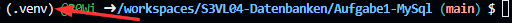
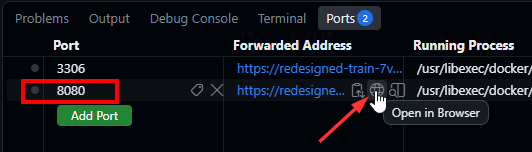

# S3VL04-Datenbanken
Repo zu S3 VL04: Übungen zu MySQL und MongoDB

## Vorbereitung

- GitHub Codespace für `DHBW-VS-Vert-Sys/S3VL04-Datenbanken` erstellen.
- Python Virtual Environment erstellen: öffne die `main.py` aus `Aufgabe1-MySql` oder `Aufgabe2-MongoDB` im Codespace und folge den Anweisungen [hier](https://github.com/DHBW-VS-Vert-Sys/S3VL03-MQTT/blob/main/README.md#vorbereitungen).
- Anschließend im Repository-Hauptverzeichnis die benötigten Python-Pakete installieren:

```bash
pip install -r requirements.txt
```

- Stelle stets sicher, dass dein aktuelles Terminal auch die Python Virtual Environment aktiviert hat. Das erkennst du an einem vorangestellten `(venv)` im Terminal-Prompt.



## Aufgabe 1: MySQL

> Um die `main.py` auszuführen, öffne ein neues Terminal und wechsele zunächst in das Unterverzeichnis `Aufgabe1-MySql` (`cd Aufgabe1-MySql`). Alle nachfolgenden Kommandos sind in diesem Unterverzeichnis auszuführen.

### Analyse des Projekt

Bevor du mit der Aufgabe beginnst, analysiere zunächst die folgenden Dateien im Unterverzeichnis `Aufgabe1-MySql`:

| Datei | Beschreibung |
|-------|--------------|
| `main.py` | Enthält die Python-Implementierung und Aufgaben für die MySQL-Datenbank. |
| `docker-compose.yml` | Enthält die Docker Services für die MySQL-Datenbank und PHPMyAdmin. |
| `init.sql` | Enthält die Initialisierungs-SQL-Befehle für die MySQL-Datenbank. |

Starte anschließend die Docker-Container mit dem folgenden Befehl:

```bash
docker-compose up -d
```

Sobald alle Services laufen, nutze PHPMyAdmin, um die MySQL-Datenbank zu analysieren.

> **Hinweis:** da GitHub Codespaces in der Cloud läuft, müssen Ports für externe Zugriffe weitergeleitet werden. GitHub generiert hierfür automatisch entsprechende Links. Nutze dazu die Port-Forwarding-Funktion von Codespaces. Diese zeigt die weitergeleiteten Ports und die entsprechenden Links an.


### Aufgaben

- Kommentiere zunächst die Beispiele in `Aufgabe1-MySql/main.py` ein und führe das Script aus per `python main.py` (im Unterverzeichnis `Aufgabe1-MySql`). 
- Überprüfe die Ergebnisse in der MySQL-Datenbank über PHPMyAdmin. 
- Bearbeite anschließend Aufgaben 1-3 in `Aufgabe1-MySql/main.py`. Aufgabe 4 (Ausgabe aller User mit ihren Bestellungen per `LEFT JOIN`) ist optional.

Bei Aufgabe 3 wird versucht, einen User zu löschen, für den noch Bestellungen existieren. Beobachte die ausgelöste Exception und erkläre, wie der Fremdschlüssel in `init.sql` das Löschen beeinflusst.

**Bonus:** Versuche dich an der SQL-Injection Aufgabe. Kommentiere dazu die entsprechenden Beispiele in `Aufgabe1-MySql/main.py` ein und führe das Script aus.
Überprüfe die Ergebnisse erneut in der MySQL-Datenbank über PHPMyAdmin. Was fällt auf? Was ist passiert?

### Cleanup

Stoppe alle Docker-Container mit dem folgenden Befehl:

```bash
docker-compose down
```

Die Datenbankdaten bleiben dabei im Docker-Volume erhalten. Um die Datenbank vollständig zurückzusetzen, kannst du `docker-compose down -v` verwenden. **Achtung:** Dadurch werden die gespeicherten Daten gelöscht.

## Aufgabe 2: MongoDB

> Um die `main.py` auszuführen, öffne ein neues Terminal und wechsele zunächst in das Unterverzeichnis `Aufgabe2-MongoDB` (`cd Aufgabe2-MongoDB`). Alle nachfolgenden Kommandos sind in diesem Unterverzeichnis auszuführen.

### Analyse des Projekt

Bevor du mit der Aufgabe beginnst, analysiere zunächst die folgenden Dateien im Unterverzeichnis `Aufgabe2-MongoDB`:

| Datei | Beschreibung |
|-------|--------------|
| `main.py` | Enthält die Python-Implementierung und Aufgaben für die MongoDB-Datenbank. |
| `docker-compose.yml` | Enthält die Docker Services für die MongoDB-Datenbank und Mongo Express. |
| `init-mongo.js` | Enthält die Initialisierungs-JavaScript-Befehle für die MongoDB-Datenbank. |

Vergleiche in `init-mongo.js` auch die getrennten Collections `users` und `orders` mit der Collection `embeddedUsers`, in der Bestellungen direkt im User-Dokument eingebettet sind.

Starte anschließend die Docker-Container mit dem folgenden Befehl:

```bash
docker-compose up -d
```

Sobald alle Services laufen, nutze Mongo Express, um die MongoDB-Datenbank zu analysieren. Nutze diesmal das Codespaces Port-Forwarding auf Port `8081`, um auf Mongo Express zuzugreifen. Um dich einzuloggen, nutze die Standard-Zugangsdaten:

- Benutzername: `admin`
- Passwort: `pass`

### Aufgaben

- Kommentiere zunächst die Beispiele in `Aufgabe2-MongoDB/main.py` ein und führe das Script aus per `python main.py` (im Unterverzeichnis `Aufgabe2-MongoDB`).
- Überprüfe die Ergebnisse in der MongoDB-Datenbank über Mongo Express.
- Bearbeite anschließend Aufgaben 1-3 in `Aufgabe2-MongoDB/main.py`. Aufgabe 4 (Ausgabe aller User mit ihren Bestellungen per `$lookup`) ist optional.

Beobachte bei Aufgabe 3, was nach dem Löschen des Users mit dessen Bestellung in der separaten `orders`-Collection passiert. MongoDB erzwingt hier keine Fremdschlüsselbeziehung wie die MySQL-Datenbank.

### Cleanup

Stoppe alle Docker-Container mit dem folgenden Befehl:

```bash
docker-compose down
```

Die Datenbankdaten bleiben dabei im Docker-Volume erhalten. Um die Datenbank vollständig zurückzusetzen, kannst du `docker-compose down -v` verwenden. **Achtung:** Dadurch werden die gespeicherten Daten gelöscht.
